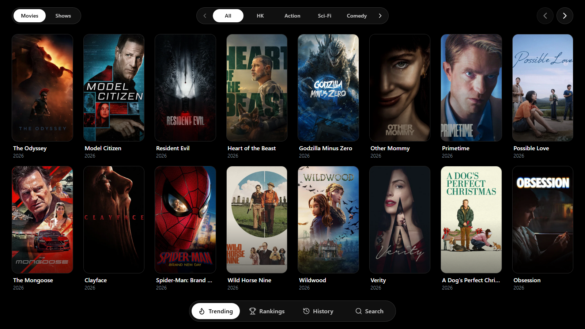

# 101Movies

A minimalist, zero-scroll movie and TV show discovery and streaming web application built for **Desktop**, **iOS/Mobile**, and **Smart TVs**, powered by **React**, **Vite**, **Tailwind CSS v4**, **TMDB**, **TVBox VOD aggregation**, and **Cloudflare Pages Functions**.

**Live Site:** [https://101movies.pages.dev](https://101movies.pages.dev)



## Features

- **Zero-Scroll Aspect-Aware Grid**: Dynamically adapts column and row density (`2`–`8` columns, `1`–`3` rows via `getGridLayout`) to viewport width and height so posters maintain natural framing and uniform vertical spacing across portrait phones, tablets, tall monitors, widescreen desktops, and mobile landscape viewports.
- **Floating Bottom Navigation Capsule**: Smooth sliding indicator between four standalone top-level views:
  - **Trending (`/`):** Browse trending Movies and Shows by category with capsule switchers, pagination buttons, and horizontal touch swipe support.
  - **Rankings (`/rankings`):** Top-rated Movies and Shows ranked by genre and release year (`1970` to current year) with scrollable capsule pickers and ranked badges.
  - **History (`/history`):** Dedicated Watch History page stored locally in `localStorage`, featuring `All` / `Movies` / `Shows` filters, per-card removal, one-click `Clear`, pagination, and touch swipe navigation.
  - **Search (`/search`):** Instant search across TMDB movies and TV shows.
- **TVBox VOD Streaming & Player (`/player/:type/:id`):** Multi-source stream resolution and HLS proxy endpoints paired with `hls.js` playback, episode selection for series, and source switching.
- **Dynamic Open Graph Link Previews:** Sharing a `/player/:type/:id` link unfurls title-specific metadata (title, rating, year, overview, and TMDB backdrop/poster) at the edge via Cloudflare Pages Functions (`functions/player/[type]/[id].ts`).
- **Smart TV & Touch Friendly:** Keyboard/D-pad focus navigation, `@vitejs/plugin-legacy` polyfills for older Smart TV WebViews, safe-area padding for notched devices, and smooth horizontal swipe gestures.
- **Server-Side API Key Security:** TMDB requests are proxied through Express (`server.ts`) locally or Cloudflare Pages Functions (`functions/api/`) in production so `TMDB_API_KEY` is never exposed to browser clients.

## Tech Stack

- **Frontend:** React 19, TypeScript, Vite 6, Tailwind CSS v4, React Router DOM 7, Lucide Icons, HLS.js, `@vitejs/plugin-legacy`
- **Local Dev Server:** Express (`tsx server.ts`) with integrated Vite middleware
- **Production Edge Backend:** Cloudflare Pages Functions (`wrangler.toml`)

## Project Structure

```text
├── functions/
│   ├── _shared/
│   │   ├── tmdb.ts                 # Shared TMDB fetch & detail helpers
│   │   └── tvboxService.ts         # Edge TVBox config/VOD resolution helpers
│   ├── api/
│   │   ├── _middleware.ts          # Shared API middleware & CORS headers
│   │   ├── tmdb/
│   │   │   ├── discover/[type].ts  # Rankings / year & genre discovery
│   │   │   ├── movie/[id].ts       # Movie details
│   │   │   ├── tv/[id].ts          # TV show details
│   │   │   ├── search.ts           # Multi-search endpoint
│   │   │   └── trending/
│   │   │       ├── movie.ts        # Trending / category movies
│   │   │       └── tv.ts           # Trending / category TV shows
│   │   ├── tvbox/
│   │   │   ├── configs.ts          # Preset TVBox configuration list
│   │   │   └── parse.ts            # Parse custom/preset TVBox JSON configs
│   │   └── vod/
│   │       ├── ping/[siteId].ts    # Check VOD source availability
│   │       ├── proxy.ts            # HLS / media stream proxy
│   │       └── resolve.ts          # Resolve playback streams for a title
│   └── player/[type]/[id].ts       # Dynamic Open Graph meta injection for shared links
├── public/                         # Static icons, manifest, sitemap, preview & OG images
├── src/
│   ├── components/
│   │   ├── ErrorBoundary.tsx
│   │   ├── HlsPlayer.tsx           # HLS.js & native video player wrapper
│   │   ├── Layout.tsx              # App shell + 4-tab floating bottom nav bar
│   │   ├── MediaCard.tsx           # Poster card with optional rank badge & remove button
│   │   └── TvboxModal.tsx          # TVBox source configuration modal
│   ├── pages/
│   │   ├── Home.tsx                # Trending view
│   │   ├── Rankings.tsx            # Rankings view (year + genre filters)
│   │   ├── History.tsx             # Standalone Watch History view
│   │   ├── Search.tsx              # Search view
│   │   └── Player.tsx              # Details, source picker & video player
│   ├── server/
│   │   └── tvboxService.ts         # Node/Express TVBox service implementation
│   ├── App.tsx                     # Client router
│   ├── api.ts                      # Frontend API client
│   ├── index.css                   # Tailwind v4 setup & custom utilities
│   ├── main.tsx                    # App entry point
│   ├── types.ts                    # Shared MediaItem & category definitions
│   └── utils.ts                    # Grid sizing, watch history & scroll helpers
├── index.html
├── package.json
├── server.ts                       # Local Express + Vite dev/prod server
├── tsconfig.json
├── vite.config.ts
└── wrangler.toml                   # Cloudflare Pages configuration
```

## Getting Started

### 1. Prerequisites

- Node.js 18+ (20+ recommended)
- A [TMDB API Key](https://www.themoviedb.org/settings/api)

### 2. Installation

```bash
npm install
```

### 3. Environment Variables

Copy `.env.example` to `.env` for local development and set your TMDB key:

```env
TMDB_API_KEY=your_tmdb_api_key_here
```

For local `wrangler pages dev` testing, put secrets in `.dev.vars` (`TMDB_API_KEY=your_tmdb_api_key_here`) and never commit `.env` or `.dev.vars`.

### 4. Local Development

Start the Express + Vite full-stack dev server:

```bash
npm run dev
```

Or preview the compiled build with Cloudflare Pages Functions locally:

```bash
npm run build
npm run pages:dev
```

### 5. Scripts

| Script | Command | Description |
| :--- | :--- | :--- |
| `npm run dev` | `tsx server.ts` | Start local Express + Vite dev server |
| `npm run build` | `vite build` | Build production assets into `dist/` |
| `npm run lint` | `tsc --noEmit` | Run TypeScript type checking |
| `npm run pages:dev` | `wrangler pages dev dist` | Run local Cloudflare Pages Functions preview |
| `npm run pages:deploy` | `wrangler pages deploy dist` | Build output & deploy manually to Cloudflare Pages |
| `npm run build:server` | `tsc -p tsconfig.server.json` | Compile Express server bundle |
| `npm start` | `node dist-server/server.js` | Run compiled Node production server |

## Deployment (Cloudflare Pages)

This project is configured via [`wrangler.toml`](wrangler.toml) for Cloudflare Pages with Node.js compatibility (`nodejs_compat`) and build output directory `dist`.

1. Connect the repository to **Cloudflare Pages** (or deploy via `npm run pages:deploy`).
2. Set the build command to `npm run build` and output directory to `dist`.
3. Add `TMDB_API_KEY` under **Settings -> Environment variables** in your Cloudflare Pages dashboard (and redeploy if adding it for the first time).
