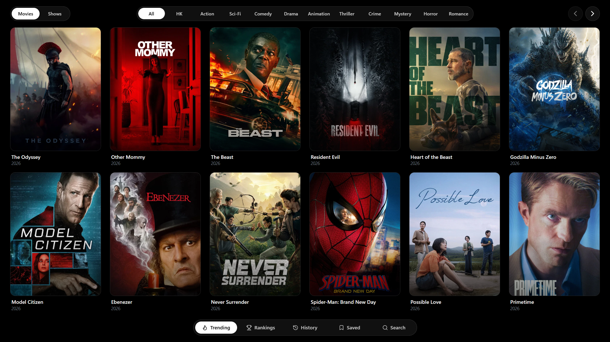

# 101Movies

A fast, keyboard-first streaming discovery and HLS playback web application built with zero-framework Vanilla TypeScript, HTML5, and modular CSS, powered by TMDB metadata, TVBox / VOD source resolution, and Cloudflare Pages Functions.



## Features

- **Trending & Rankings Discovery**: Browse trending and yearly top-rated Movies & Shows across a 12-category filter bar (`All`, `HK`, `Action`, `Sci-Fi`, `Comedy`, `Drama`, `Animation`, `Thriller`, `Crime`, `Mystery`, `Horror`, `Romance`) verified against live VOD source availability.
- **5-Tab Navigation (`Trending`, `Rankings`, `History`, `Saved`, `Search`)**:
  - **History**: Tracks titles you have actually played, along with episode/progress timestamps for instant resume and one-click removal.
  - **Saved**: Bookmark movies and shows directly from their detail view without polluting Watch History.
  - **Search**: Multi-language TMDB search with live VOD source filtering.
- **Detail View & Instant Playback**:
  - Full-bleed untinted TMDB backdrop artwork with clean typography and poster framing.
  - Dedicated **Save / Saved** bookmark control and direct **IMDb** link on the title action bar.
  - 150 ms hover/focus intent prefetching for TMDB metadata and VOD stream resolution into an in-memory cache.
  - Adaptive HLS streaming powered by `hls.js` with Smart TV-safe memory bounds (`maxBufferLength: 60`, `maxBufferSize: 60000000`, `backBufferLength: 30`) and strict buffer teardown on exit.
  - Multi-source switching and custom TVBox JSON source configuration (`Sources` modal).
- **Smart TV & Keyboard Spatial Navigation**: Full D-Pad / Arrow key, `Enter`, and `Escape` / `Back` spatial navigation across cards, pill tracks, detail controls, and player overlays alongside standard mouse and touch input.
- **Dynamic Open Graph Link Previews**:
  - `1200x630` darkroom contact-sheet site card (`public/og-image.png`).
  - On-the-fly per-title `1200x630` PNG Open Graph cards rendered at `/api/og/:type/:id` via `@cf-wasm/resvg` and injected server-side by Cloudflare Pages `HTMLRewriter` (`functions/player/[type]/[id].ts`).


## Tech Stack

- **Frontend**: Pure Vanilla TypeScript, Semantic HTML5, Modular CSS, Inline SVGs (zero UI framework dependencies)
- **Bundler**: Vite 6
- **Video Streaming**: `hls.js`
- **Local Development Server**: Express + `tsx` + Vite middleware (`server.ts`)
- **Edge Serverless Backend**: Cloudflare Pages Functions (`functions/`) + `@cf-wasm/resvg` for dynamic OG image generation

## Project Structure

```text
101movies/
├── functions/                  # Cloudflare Pages Functions (production edge API & SSR meta)
│   ├── _shared/
│   │   ├── ogCard.ts           # SVG card builder for dynamic 1200x630 Open Graph previews
│   │   ├── tmdb.ts             # TMDB helpers & genre resolution
│   │   └── tvboxService.ts     # VOD source parsing & stream resolver
│   ├── api/
│   │   ├── _middleware.ts      # CORS & error handling middleware
│   │   ├── og/[type]/[id].ts   # Edge PNG renderer (@cf-wasm/resvg/workerd)
│   │   ├── tmdb/               # Read-only edge-cached TMDB proxy routes
│   │   ├── tvbox/              # TVBox config listing & parser routes
│   │   └── vod/                # Stream resolution, ping & proxy routes
│   └── player/[type]/[id].ts   # HTMLRewriter OG & Twitter meta injection for shared links
├── public/
│   ├── fonts/                  # Bundled static Poppins TTF fonts for OG rendering
│   ├── og-image.png            # Site Open Graph preview (1200x630)
│   ├── preview.png             # Application screenshot
│   ├── robots.txt
│   ├── site.webmanifest
│   └── sitemap.xml
├── src/
│   ├── components/
│   │   ├── HlsPlayer.ts        # Adaptive HLS player with strict lifecycle cleanup
│   │   ├── MediaCard.ts        # Poster card with hover/focus intent prefetching
│   │   └── TvboxModal.ts       # Custom VOD source manager modal
│   ├── pages/
│   │   ├── History.ts          # Watch history view
│   │   ├── Home.ts             # Trending feed & category pill navigation
│   │   ├── Player.ts           # Title info view, IMDb & Save actions, VOD switcher
│   │   ├── Rankings.ts         # Yearly rankings explorer
│   │   ├── SavedCollection.ts  # Shared filterable grid engine for History & Saved
│   │   ├── Search.ts           # Search interface
│   │   └── WatchLater.ts       # Saved watchlist view
│   ├── server/
│   │   └── tvboxService.ts     # Shared Node/Edge VOD source service
│   ├── api.ts                  # Client API wrapper with request abort support
│   ├── icons.ts                # Inline SVG icon registry
│   ├── index.css               # Design tokens, responsive grids & Smart TV styles
│   ├── main.ts                 # App shell & 5-tab navigation controller
│   ├── router.ts               # History API router & view cleanup lifecycle
│   ├── types.ts                # Category maps & shared data interfaces
│   └── utils.ts                # Storage helpers, horizontal swipe & layout utilities
├── index.html                  # HTML5 entry shell with preconnect & Open Graph meta
├── package.json
├── server.ts                   # Local Express + Vite development server
├── tsconfig.json
├── vite.config.ts
└── wrangler.toml
```

## Getting Started

### Prerequisites

- Node.js 20+
- A free [TMDB API Key](https://www.themoviedb.org/settings/api)

### Installation

```bash
npm install
```

Create a `.env` file in the project root based on `.env.example`:

```env
TMDB_API_KEY=your_tmdb_api_key_here
```

Start the local development server at `http://localhost:3000`:

```bash
npm run dev
```

## Scripts

| Command | Action | Description |
| :--- | :--- | :--- |
| `npm run dev` | `tsx server.ts` | Start local Express + Vite dev server with HMR |
| `npm run build` | `vite build` | Build production static frontend assets into `dist/` |
| `npm run pages:dev` | `wrangler pages dev dist` | Run local Cloudflare Pages Functions simulation |
| `npm run pages:deploy` | `wrangler pages deploy dist` | Deploy `dist/` and `functions/` to Cloudflare Pages |
| `npm run build:server` | `vite build && esbuild server.ts ...` | Bundle frontend + Node server into `dist/server.cjs` |
| `npm start` | `node dist/server.cjs` | Run the bundled Node production server |
| `npm run preview` | `vite preview` | Preview built static Vite bundle |
| `npm run clean` | `rm -rf dist server.js` | Remove build output artifacts |
| `npm run lint` | `tsc --noEmit` | Run strict TypeScript typechecking |

## Cloudflare Pages Deployment

1. Connect the repository to Cloudflare Pages or deploy manually with Wrangler:
   ```bash
   npm run build
   npx wrangler pages deploy dist
   ```
2. Set `TMDB_API_KEY` as an Environment Variable / Secret in **Cloudflare Dashboard > Pages > Settings > Environment Variables**.
3. Build command: `npm run build` · Build output directory: `dist`.

## License

[MIT](LICENSE)
