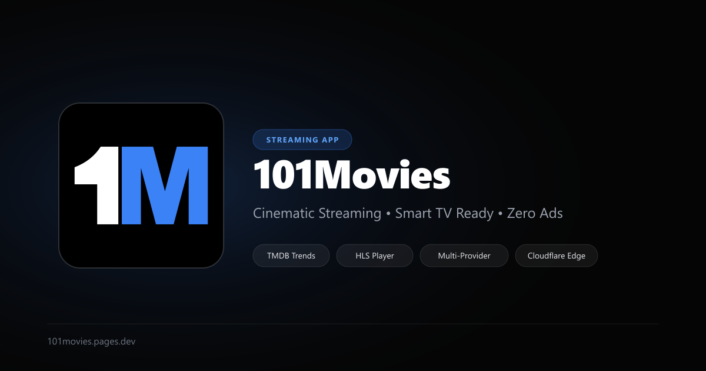

<p align="center">
  
</p>

<h1 align="center">101Movies</h1>

<p align="center">
  <strong>A sleek, cinematic web streaming application engineered for Smart TVs, desktop, and mobile browsers.</strong>
</p>

<p align="center">
  <a href="https://101movies.pages.dev"></a>
</p>

<p align="center">
  
  
  
  
  
  
</p>

---

## 🌟 Highlights

- 📺 **Smart TV First Design**: Zero-scroll locked 2x6 card viewport grid. Supports keyboard arrows, D-pad TV remotes, mouse, and touch swipe.
- 🎬 **Real-Time Trending Feeds**: Dynamic feeds powered by TMDB for both Movies and TV Shows, categorized by genre (Action, Sci-Fi, HK, Drama, Comedy, Horror, Anime, etc.).
- 🌐 **Intelligent Bilingual Resolution**: Automatically resolves English and Chinese (`zh-CN`) titles so media can match both Asian and Western VOD aggregators seamlessly.
- ⚡ **Multi-Line VOD Aggregation**: High-speed concurrent probing across multiple TVBox-compatible API providers with fallback routing.
- 🍿 **Modern Custom HLS Player**: Custom video playback engine powered by `hls.js`, with an episode selection drawer, video quality selector, full-screen mode, and keyboard shortcuts.
- ⏱️ **Watch History & Auto-Resume**: Tracks your watch progress across movies and show episodes locally without requiring login accounts.
- 🚀 **Cloudflare Edge Performance**: Cloudflare Pages Functions with subrequest concurrency pools and Edge Cache API (`caches.default`), serving repeat queries in under 50ms.
- 🛡️ **Cross-Generation TV Compatibility**: Hardened with legacy JS polyfills (`@vitejs/plugin-legacy`), CSS `@layer` unwrapping, safe `scrollTo` fallbacks, and a React Error Boundary to run flawlessly on older TV browsers (Samsung Tizen, LG webOS).

---

## 📸 Preview

<p align="center">
  
</p>

---

## 🛠️ Tech Stack

| Layer | Technology |
|---|---|
| **Frontend Framework** | [React 19](https://react.dev/) + [TypeScript](https://www.typescriptlang.org/) |
| **Styling & Design** | [Tailwind CSS v4](https://tailwindcss.com/) + [Lucide Icons](https://lucide.dev/) |
| **Media Player** | [HLS.js](https://github.com/video-dev/hls.js/) |
| **Routing** | [React Router DOM v7](https://reactrouter.com/) |
| **Build & Polyfills** | [Vite 6](https://vitejs.dev/) + [`@vitejs/plugin-legacy`](https://github.com/vitejs/vite/tree/main/packages/plugin-legacy) |
| **Serverless Backend** | [Cloudflare Pages Functions](https://developers.cloudflare.com/pages/platform/functions/) |
| **Edge Caching** | Cloudflare Cache API (`caches.default`) |
| **Metadata API** | [The Movie Database (TMDB)](https://www.themoviedb.org/) |

---

## 📁 Project Structure

```text
101movies/
├── functions/                     # Cloudflare Pages Functions (Edge API)
│   ├── _shared/
│   │   └── tvboxService.ts        # Multi-provider VOD scraper & concurrency pool
│   └── api/
│       ├── _middleware.ts         # Edge caching middleware (TTL: 1h - 24h)
│       ├── tmdb/                  # Proxies TMDB with Chinese title batching
│       │   ├── trending/          # Movies & TV trending endpoints
│       │   ├── rankings/          # Yearly/genre rankings
│       │   ├── search.ts          # Search with bilingual title enhancement
│       │   └── details.ts         # Title & metadata resolution
│       └── tvbox/                 # TVBox line scraping & episode extraction
├── public/                        # Static assets & SEO files
│   ├── favicon.svg                # Scalable 1M vector favicon
│   ├── favicon.ico                # Multi-resolution ICO
│   ├── apple-touch-icon.png       # iOS home screen icon (180x180)
│   ├── android-chrome-192x192.png # PWA 192px icon
│   ├── android-chrome-512x512.png # PWA 512px icon
│   ├── og-image.png               # Social preview banner (1200x630)
│   ├── robots.txt                 # Search engine crawler instructions
│   ├── sitemap.xml                # SEO sitemap
│   └── site.webmanifest           # Progressive Web App manifest
├── src/
│   ├── components/                # Reusable UI components
│   │   ├── ErrorBoundary.tsx      # Crash protection for TV browsers
│   │   ├── HlsPlayer.tsx          # Custom HLS video player
│   │   ├── Layout.tsx             # Responsive shell & capsule nav
│   │   ├── MediaCard.tsx          # Poster card with hover/focus states
│   │   └── TvboxModal.tsx         # Source provider & line switcher
│   ├── pages/
│   │   ├── Home.tsx               # Trending Movies, Shows & Watch History
│   │   ├── Rankings.tsx           # Decade & Genre Rankings grid
│   │   ├── Search.tsx             # Live instant search
│   │   └── Player.tsx             # Playback view with episode drawer
│   ├── api.ts                     # Client-side API abstraction
│   ├── index.css                  # Global styles & Flexbox fallbacks
│   ├── main.tsx                   # Entry point with scrollTo polyfills
│   ├── types.ts                   # TypeScript data definitions
│   └── utils.ts                   # Utility functions & safeScrollTo helper
├── index.html                     # HTML template with complete SEO meta & JSON-LD
├── vite.config.ts                 # Vite config with legacy polyfills & CSS transforms
└── wrangler.jsonc                 # Cloudflare configuration
```

---

## 🚀 Getting Started

### Prerequisites

- [Node.js](https://nodejs.org/) (version 18 or later recommended)
- A [TMDB API Read Access Token or API Key](https://www.themoviedb.org/settings/api)

### 1. Clone the repository

```bash
git clone https://github.com/dexterchock/101movies.git
cd 101movies
```

### 2. Install dependencies

```bash
npm install
```

### 3. Configure Environment Variables

Create a `.env` file in the project root:

```env
# Optional TMDB Bearer Token or API Key for local development
TMDB_READ_TOKEN=your_tmdb_read_access_token_here
# or
VITE_TMDB_API_KEY=your_tmdb_api_key_here
```

### 4. Run the Development Server

To run the local Vite development server:

```bash
npm run dev
```

To test with Cloudflare Pages Functions locally (using Wrangler):

```bash
npm run build
npm run pages:dev
```

Open `http://localhost:5173` or `http://localhost:8788` in your browser.

---

## 🚢 Deployment

### Deploy to Cloudflare Pages

This project is tailored for zero-config deployment on Cloudflare Pages:

1. Connect your GitHub repository to Cloudflare Pages.
2. Set the build settings:
   - **Framework preset**: `None` / `Vite`
   - **Build command**: `npm run build`
   - **Build output directory**: `dist`
3. Add the Environment Variable in your Cloudflare Pages dashboard:
   - `TMDB_READ_TOKEN`: *your TMDB API token*
4. Deploy!

Or deploy directly via Wrangler CLI:

```bash
npm run build
npx wrangler pages deploy dist --project-name 101movies
```

---

## 📺 Smart TV Engineering

Smart TV browsers (such as older Samsung Tizen and LG webOS models running Chromium 47–69) frequently lack modern web features or enforce strict memory/subrequest limits. This project implements several critical adaptations:

1. **JavaScript Polyfill Injection**: `@vitejs/plugin-legacy` transpiles code down to `chrome >= 60`, `safari >= 11`, and `edge >= 79`, supplying `regenerator-runtime` and `core-js` polyfills automatically.
2. **CSS Compatibility Transform**: Custom Vite build plugins unwrap modern CSS `@layer` rules and replace modern `oklch()` color functions with universal HEX values.
3. **Safe Horizontal Scrolling**: Legacy TV engines throw unhandled exceptions when `element.scrollTo({ left, behavior: 'smooth' })` is invoked with an options object. A global prototype polyfill and `safeScrollTo()` helper automatically fall back to `element.scrollLeft = value`.
4. **CSS Grid Fallbacks**: Flexbox wrapping rules ensure cards remain in structured columns even if the TV engine cannot parse CSS subgrid or multi-track CSS Grid.
5. **Subrequest Batching & Edge Caching**: Avoids Cloudflare's 50-subrequest limit by batching queries and persisting responses at the edge via Cloudflare Cache API.

---

## ⚖️ Disclaimer

**101Movies** is an open-source educational project developed for pair-programming and web technology research.

- 101Movies does **not** host, upload, or store any video files or media streams on any servers.
- All media metadata is provided by [The Movie Database (TMDB)](https://www.themoviedb.org/).
- All video streams and playlist URLs are indexed dynamically from third-party public API endpoints.
- Users are responsible for complying with the copyright and intellectual property laws of their respective jurisdictions.

---

## 📄 License

This project is open-source under the [MIT License](LICENSE).
