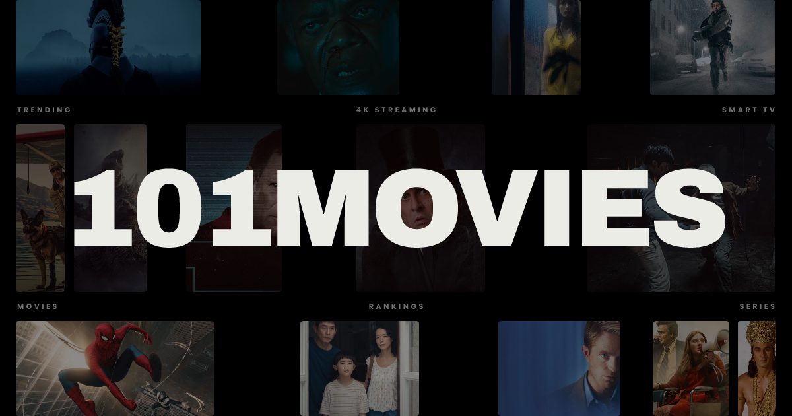

# 101Movies

A keyboard and remote friendly streaming discovery and HLS playback web app built with Vanilla TypeScript, HTML5, and modular CSS (zero UI frameworks), powered by TMDB metadata, VOD source resolution, Cloudflare Pages Functions, and Cloudflare D1.

Live site: [101movies.pages.dev](https://101movies.pages.dev)


## Features

* **Trending & Rankings Discovery**: Browse trending and yearly top rated Movies and Shows across a 12 category filter bar (`All`, `HK`, `Action`, `Sci-Fi`, `Comedy`, `Drama`, `Animation`, `Thriller`, `Crime`, `Mystery`, `Horror`, `Romance`) filtered against live VOD source availability.
* **5 Tab Navigation (`Trending`, `Rankings`, `History`, `Saved`, `Search`)**:
  * **History**: Tracks played titles along with episode and playback timestamps for instant resume and one click removal.
  * **Saved**: Bookmarks movies and shows from the detail view without cluttering History.
  * **Search**: Multi language TMDB search with Simplified Chinese normalization, live VOD filtering, and `/search?q=` URL query sync.
* **Accountless Device Sync (Cloudflare D1)**:
  * Pair devices from the History or Saved view with a temporary 4 digit code (5 minute expiry) that submits automatically on the 4th digit.
  * First time pairing merges History and Saved across both devices instead of overwriting either list.
  * Keeps D1 reads and writes light via `since` timestamp checks and batched sync updates, with inline disconnect options (`Keep local copy` or `Clear & disconnect`).
  * Falls back to an in memory store during local development when no D1 database is bound.
* **Playback, HLS & Desktop AI Upscaling**:
  * Full bleed untinted TMDB backdrops (`original` quality, with a `w342` blurred fallback when no backdrop exists), Save bookmark toggle, direct IMDb link, and 150 ms hover or focus intent prefetching.
  * Lazy loaded `hls.js` (`v1.6.16`) fetched on demand on the player route (skipped on iOS Safari in favor of native HLS), tuned with Smart TV memory caps (`maxBufferLength: 60`, `maxBufferSize: 60000000`, `backBufferLength: 30`) and strict teardown on exit.
  * Hardened `/api/vod/proxy` edge proxy with private IP and redirect SSRF checks, playlist MIME verification, and same origin CORS.
  * Desktop fullscreen AI video upscaling (`Upscale` button, hidden on phones, tablets, and Smart TVs) using lazy loaded WebSR (`anime4k/cnn-2x-m` on WebGPU, `cnn-2x-l` on WebGL2 fallback), automatic anime vs live action weight selection from TMDB genres, and automatic GPU buffer teardown on fullscreen exit.
* **Performance & Smart TV Support**:
  * Targets ES2015 / Chromium 56 (`src/polyfills.ts`, `@supports not (display: grid)` flexbox fallbacks, Tizen Return and Select remote key handling) for Samsung Tizen 4.0 and older TV browsers.
  * Small initial IIFE bundle (~41 KiB gzipped) with responsive poster `srcset` (`w342`, `w500`), `fetchpriority="high"` on first row cards, deferred inactive tab preloading, and immutable cache headers (`public/_headers`).
  * Full D Pad / Arrow key, `Enter`, and `Escape` / `Back` spatial navigation alongside mouse and touch controls.
* **Dynamic Open Graph Link Previews**:
  * Static `1200x630` site card (`public/og-image.png`) and on the fly per title `1200x630` PNG cards rendered at `/api/og/:type/:id` via `@cf-wasm/resvg`, injected server side by Cloudflare Pages `HTMLRewriter` (`functions/player/[type]/[id].ts`).



## Tech Stack

* **Frontend**: Vanilla TypeScript, semantic HTML5, modular CSS, inline SVGs (zero UI framework dependencies)
* **Bundler**: Vite 6 (ES2015 / `chrome56` IIFE target)
* **Streaming & Upscaling**: On demand `hls.js` (`v1.6.16`) and WebSR (`@websr/websr` WebGPU + `@websr/webgl` WebGL2)
* **Local Dev Server**: Express + `tsx` + Vite middleware (`server.ts`)
* **Edge Backend & Storage**: Cloudflare Pages Functions (`functions/`), Cloudflare D1 (`101movies-sync`), and `@cf-wasm/resvg`

## Project Structure

```text
101movies/
├── functions/                      # Cloudflare Pages Functions (edge API & SSR meta)
│   ├── _shared/
│   │   ├── ogCard.ts               # SVG card builder for dynamic 1200x630 OG previews
│   │   ├── syncService.ts          # D1 & memory device sync, pairing & list merging
│   │   ├── tmdb.ts                 # TMDB helpers & genre resolution
│   │   ├── tvboxService.ts         # VOD source parsing & stream resolver
│   │   └── vodProxy.ts             # Hardened HLS stream proxy with SSRF protection
│   ├── api/
│   │   ├── _middleware.ts          # Same origin CORS & error handling middleware
│   │   ├── og/[type]/[id].ts       # Edge PNG renderer (@cf-wasm/resvg/workerd)
│   │   ├── sync/                   # Pairing code, handshake & sync state routes
│   │   ├── tmdb/                   # Read only edge cached TMDB proxy routes
│   │   ├── tvbox/                  # TVBox config listing & parser routes
│   │   └── vod/                    # Stream resolution, ping & proxy routes
│   └── player/[type]/[id].ts       # HTMLRewriter OG & Twitter meta injection
├── public/
│   ├── _headers                    # Cloudflare Pages cache control headers
│   ├── fonts/                      # Bundled Poppins TTF fonts for OG rendering
│   ├── upscaler/                   # Lazy loaded WebSR runtimes & Anime4K weights
│   ├── vendor/                     # Lazy loaded hls.js ES5 bundle
│   ├── og-image.png                # Site Open Graph preview (1200x630)
│   ├── preview.png                 # Application screenshot
│   ├── llms.txt
│   ├── robots.txt
│   ├── site.webmanifest
│   └── sitemap.xml
├── src/
│   ├── components/
│   │   ├── HlsPlayer.ts            # On demand HLS player with TV memory limits
│   │   ├── MediaCard.ts            # Responsive poster card & intent prefetching
│   │   ├── SyncModal.ts            # 4 digit pairing & disconnect modal
│   │   └── VideoUpscaler.ts        # Desktop WebGPU / WebGL2 fullscreen upscaler
│   ├── pages/
│   │   ├── History.ts              # Watch history view
│   │   ├── Home.ts                 # Trending feed & category pill navigation
│   │   ├── Player.ts               # Title view, IMDb & Save actions, VOD switcher
│   │   ├── Rankings.ts             # Yearly rankings explorer
│   │   ├── SavedCollection.ts      # Shared grid & Sync control for History & Saved
│   │   ├── Search.ts               # Search interface with /search?q= URL sync
│   │   └── WatchLater.ts           # Saved watchlist view
│   ├── server/
│   │   └── tvboxService.ts         # Shared Node / Edge VOD source service
│   ├── api.ts                      # Client API wrapper with request abort support
│   ├── icons.ts                    # Inline SVG icon registry
│   ├── index.css                   # Design tokens, grids & Tizen flexbox fallbacks
│   ├── main.ts                     # App shell, 5 tab navigation & bundle check
│   ├── polyfills.ts                # Chromium 56 / Smart TV runtime polyfills
│   ├── router.ts                   # History API router & view cleanup lifecycle
│   ├── sync.ts                     # Client sync state, merge & throttled push/pull
│   ├── types.ts                    # Category maps & shared data interfaces
│   ├── utils.ts                    # Storage helpers, horizontal swipe & layout utils
│   └── zhSimp.ts                   # Traditional to Simplified Chinese search helper
├── index.html                      # HTML5 entry shell with preconnect & OG meta
├── package.json
├── server.ts                       # Local Express + Vite development server
├── tsconfig.json
├── vite.config.ts
└── wrangler.toml                   # Cloudflare Pages & D1 database binding config
```

## Getting Started

### Prerequisites

* Node.js 20+
* A free [TMDB API Key](https://www.themoviedb.org/settings/api)

### Installation

```bash
npm install
```

Create a `.env` file in the project root with your TMDB API key:

```env
TMDB_API_KEY=your_tmdb_api_key_here
```

Start the local development server at `http://localhost:3000`:

```bash
npm run dev
```

Device sync uses an automatic in memory store during local development whenever no D1 binding is configured.

## Scripts

| Command | Action | Description |
| :--- | :--- | :--- |
| `npm run dev` | `tsx server.ts` | Start local Express + Vite dev server with HMR |
| `npm run build` | `vite build` | Build production static frontend assets into `dist/` |
| `npm run pages:dev` | `wrangler pages dev dist` | Run local Cloudflare Pages Functions simulation |
| `npm run pages:deploy` | `wrangler pages deploy dist` | Deploy `dist/` and `functions/` to Cloudflare Pages |
| `npm run build:server` | `vite build && esbuild server.ts ...` | Bundle frontend + Node server into `dist/server.cjs` |
| `npm start` | `node dist/server.cjs` | Run the bundled Node production server |
| `npm run preview` | `vite preview` | Preview built static Vite bundle |
| `npm run clean` | `rm -rf dist server.js` | Remove build output artifacts |
| `npm run lint` | `tsc --noEmit` | Run strict TypeScript typechecking |

## Cloudflare Pages & D1 Deployment

1. Create a Cloudflare D1 database and update `database_id` in `wrangler.toml`:
   ```bash
   npx wrangler d1 create 101movies-sync
   ```
2. Initialize the `sync_groups` and `sync_codes` tables:
   ```bash
   npx wrangler d1 execute 101movies-sync --remote --command "CREATE TABLE IF NOT EXISTS sync_groups (group_id TEXT PRIMARY KEY, history_json TEXT NOT NULL, saved_json TEXT NOT NULL, paired INTEGER NOT NULL DEFAULT 0, updated_at INTEGER NOT NULL); CREATE TABLE IF NOT EXISTS sync_codes (code TEXT PRIMARY KEY, group_id TEXT NOT NULL, expires_at INTEGER NOT NULL);"
   ```
3. Bind the database as `DB` in **Cloudflare Dashboard > Pages > Settings > Bindings** and add `TMDB_API_KEY` under **Environment Variables**.
4. Connect the repository to Cloudflare Pages (build command `npm run build`, output directory `dist`) or deploy manually:
   ```bash
   npm run build
   npx wrangler pages deploy dist
   ```

## License

[MIT](LICENSE)
